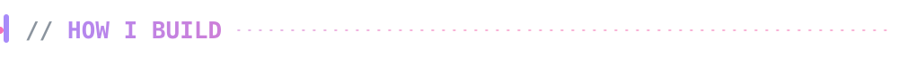
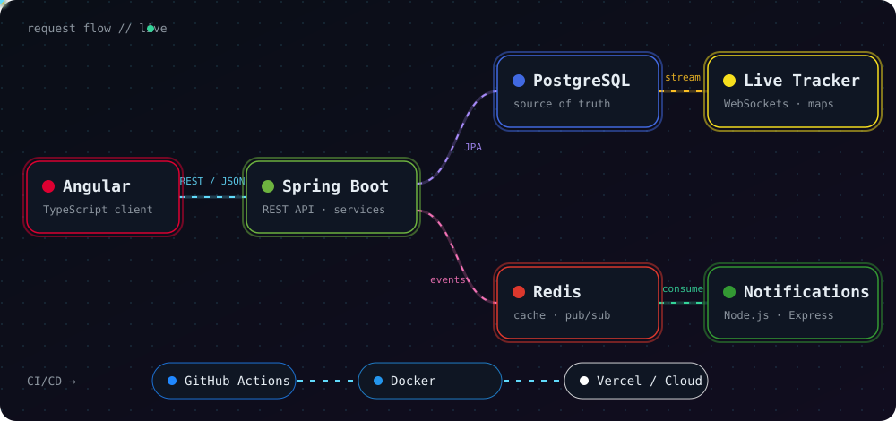

<div align="center">


<a href="https://aaditya514-github-io.vercel.app/"></a>
<a href="https://www.linkedin.com/in/aadityaaanand514"></a>


</div>

<br/>


<br/>


- 🔭 **Current Focus:** Crafting robust backend architectures, scalable microservices, and modern web applications.
- 🎓 **Education:** Computer Science student with a strong passion for Software Engineering, System Design, and Algorithms.
- 🚀 **Building Impactful Projects:** Architecting solutions like [**auto-meds**](https://github.com/Aaditya514/auto-meds), [**priora**](https://github.com/Aaditya514/priora), and real-time event-driven pipelines.
- 💡 **Engineering Philosophy:** Clean architecture, performance optimization, and building software that delivers tangible real-world value.

<br/>


<br/>




<br/>


<br/>


<div align="center">
<a href="https://github.com/Aaditya514/auto-meds"></a>
<a href="https://github.com/Aaditya514/priora"></a>
<a href="https://github.com/Aaditya514/Notification-Service"></a>
<a href="https://github.com/Aaditya514/Real-Time-Tracker"></a>
</div>

<br/>


<!--START_SECTION:repos-->
_Syncing your latest repositories — the first refresh runs shortly._
<!--END_SECTION:repos-->

<details>
<summary><b>⚡ Latest commits</b></summary>
<br/>

<!--START_SECTION:commits-->
_Syncing…_
<!--END_SECTION:commits-->

</details>

<sub>This section refreshes itself every few hours with a GitHub Action.</sub>

<br/>


<div align="center">


<br/>

<br/>

</div>

<br/>

<picture>
  <source media="(prefers-color-scheme: dark)" srcset="https://raw.githubusercontent.com/Aaditya514/Aaditya514/output/github-snake-dark.svg" />
  <source media="(prefers-color-scheme: light)" srcset="https://raw.githubusercontent.com/Aaditya514/Aaditya514/output/github-snake.svg" />
  
</picture>

<br/>


**✨ Wanna build cool sh*t? Let's connect and create something epic together!**

<a href="https://www.instagram.com/_._aadiboi_._/"></a>
<a href="mailto:aanandaaditya5@gmail.com"></a>
<a href="https://www.linkedin.com/in/aadityaaanand514"></a>
<a href="https://www.facebook.com/share/1AZjKSRpnn/"></a>
<a href="https://discord.com/users/nihilist514"></a>

<details>
<summary><b>🕹️ <code>sudo hire --aaditya</code></b></summary>

```bash
[sudo] password for recruiter: ********
access granted ✔

→ portfolio   https://aaditya514-github-io.vercel.app/
→ linkedin    https://www.linkedin.com/in/aadityaaanand514
→ status      open to collabs · building cool sh*t
```

</details>

<br/>


