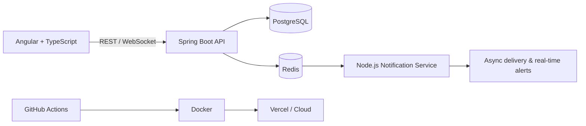

<div align="center">
  <h1>Hey there, I'm Aaditya Aanand 👋</h1>

  <a href="https://aaditya514-github-io.vercel.app/" target="_blank">
    
  </a>

  <p align="center">
    <a href="https://aaditya514-github-io.vercel.app/" target="_blank">
      
    </a>
    <a href="https://www.linkedin.com/in/aadityaaanand514" target="_blank">
      
    </a>
    
    
  </p>
</div>

<br/>

## 💫 About Me

<table>
  <tr>
    <td valign="top" width="55%">

- 🔭 **Current Focus:** Crafting robust backend architectures, scalable microservices, and modern web applications.
- 🎓 **Education:** Computer Science student with a strong passion for Software Engineering, System Design, and Algorithms.
- 🚀 **Building Impactful Projects:** Architecting solutions like [**auto-meds**](https://github.com/Aaditya514/auto-meds), [**priora**](https://github.com/Aaditya514/priora), and real-time event-driven pipelines.
- 💡 **Engineering Philosophy:** Clean architecture, performance optimization, and building software that delivers tangible real-world value.
- ⚡ **Beyond the Code:** Fascinated by human psychology, exploring nature, and bringing creative ideas to life through side projects.

  </td>
  <td valign="top" width="45%">

```bash
$ whoami
aaditya-aanand

$ cat focus.txt
Spring Boot · Angular · System design

$ cat beyond_code.txt
Psychology · nature · side projects

$ ./open_to.sh
Internships · collabs · cool sh*t
```

  </td>
  </tr>
</table>

<br/>

## 🏗️ How I Build



<br/>

## 💻 Tech Stack

<div align="center">
<table>
  <tr>
    <td><b>Languages</b></td>
    <td></td>
  </tr>
  <tr>
    <td><b>Backend</b></td>
    <td></td>
  </tr>
  <tr>
    <td><b>Frontend</b></td>
    <td></td>
  </tr>
  <tr>
    <td><b>Data</b></td>
    <td></td>
  </tr>
  <tr>
    <td><b>DevOps</b></td>
    <td></td>
  </tr>
</table>
</div>

<br/>

## 🚀 Featured Projects

<table>
  <tr>
    <td width="50%" valign="top">
      <h3>🏥 <a href="https://github.com/Aaditya514/auto-meds">auto-meds</a></h3>
      <p>Automated healthcare workflow & prescription system with microservice architecture, Docker deployment, and scalable data persistence.</p>
      <p>
        
        
        
        
      </p>
    </td>
    <td width="50%" valign="top">
      <h3>⚡ <a href="https://github.com/Aaditya514/priora">priora</a></h3>
      <p>High-efficiency priority management and productivity application engineered for streamlined task scheduling and performance.</p>
      <p>
        
        
        
      </p>
    </td>
  </tr>
  <tr>
    <td width="50%" valign="top">
      <h3>🔔 <a href="https://github.com/Aaditya514/Notification-Service">Notification-Service</a></h3>
      <p>Event-driven backend architecture for reliable asynchronous message delivery, queuing, and real-time alerts.</p>
      <p>
        
        
        
      </p>
    </td>
    <td width="50%" valign="top">
      <h3>📍 <a href="https://github.com/Aaditya514/Real-Time-Tracker">Real-Time-Tracker</a></h3>
      <p>Live real-time location telemetry system delivering bidirectional coordinate tracking and instant mapping updates.</p>
      <p>
        
        
        
      </p>
    </td>
  </tr>
</table>

<br/>

## 📊 GitHub Stats

<div align="center">
  
  
  <br/>
  
</div>

<br/>

<picture>
  <source media="(prefers-color-scheme: dark)" srcset="https://raw.githubusercontent.com/Aaditya514/Aaditya514/output/github-snake-dark.svg" />
  <source media="(prefers-color-scheme: light)" srcset="https://raw.githubusercontent.com/Aaditya514/Aaditya514/output/github-snake.svg" />
  
</picture>

<br/>

## 🌐 Socials

**✨ Wanna build cool sh*t? Let's connect and create something epic together!**

<div align="left">
  <a href="https://www.instagram.com/_._aadiboi_._/" target="_blank">
    
  </a>
  <a href="mailto:aanandaaditya5@gmail.com" target="_blank">
    
  </a>
  <a href="https://www.linkedin.com/in/aadityaaanand514" target="_blank">
    
  </a>
  <a href="https://www.facebook.com/share/1AZjKSRpnn/" target="_blank">
    
  </a>
  <a href="https://discord.com/users/nihilist514" target="_blank">
    
  </a>
</div>


